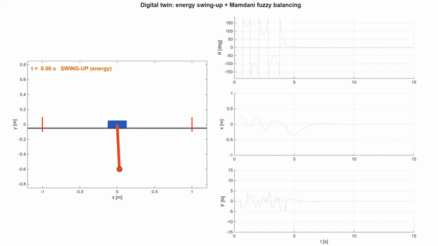
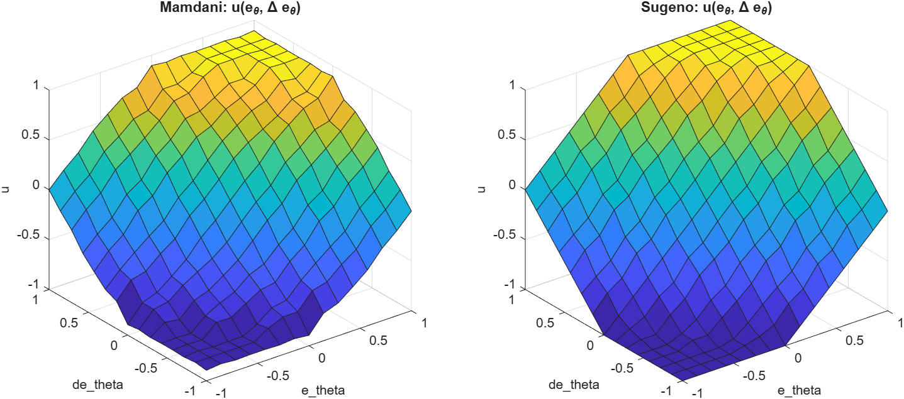
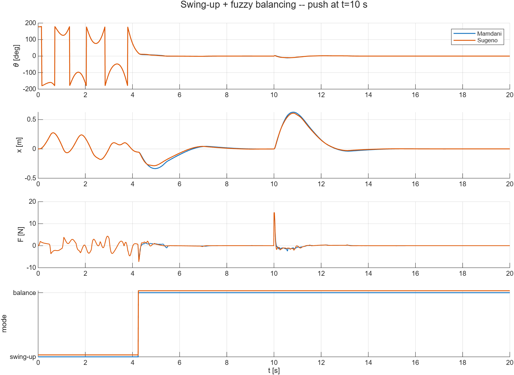

# Fuzzy swing-up and balancing of an inverted pendulum — with a Simulink digital twin



An inverted pendulum on a cart starts **hanging down**, is **swung up** with an energy-based controller and is then **balanced** by a **fuzzy logic controller**. The same fuzzy rule base is implemented as **Mamdani** and as **Sugeno** and the two are compared. The closed loop also runs in **Simulink** on a **Simscape Multibody digital twin** of the mechanism (3D view in Mechanics Explorer), validated against the analytical model, with a 2D animated dashboard and video export.

Project for the course *Artificial Intelligence Based Control* (BME). The full write-up is in [`report/report.pdf`](report/report.pdf).

---

## Quick start

Requirements: **MATLAB R2026a** (tested) with Fuzzy Logic Toolbox, Control System Toolbox, Simulink, Simscape and Simscape Multibody.

Open MATLAB in this folder and run:

```matlab
main_compare        % 1) Mamdani vs Sugeno, 4 test scenarios, MATLAB only (~10 s)
main_twin(1)        % 2) Simulink digital twin with the Mamdani controller: 3D view + 2D animation
main_twin(2)        %    same with the Sugeno controller
main_twin(1, true)  % 3) also record outputs/videos/twin_mamdani.mp4 and a GIF preview
```

To work directly in Simulink:

```matlab
init_project                              % add the folders to the path
CTRL_TYPE = 1;                            % 1 = Mamdani, 2 = Sugeno
setup_twin                                % load parameters, fuzzy systems and gains
open_system('cartpole_fuzzy_twin')        % then press Run
```

`main_compare` writes all figures, the results table (`outputs/results/comparison.csv`) and the four `.fis` files (open them with `fuzzyLogicDesigner`). After running it, `export_latex_table` refreshes the results table used by the report.

---

## How it works

```
 hanging down ──► ENERGY SWING-UP ──(|θ| < 20°)──► FUZZY BALANCING (Mamdani or Sugeno)
                          ▲                                  │
                          └──────────(|θ| > 46°)─────────────┘
```

| Part | What it does | Where |
|---|---|---|
| Plant model | Nonlinear cart-pendulum equations (Lagrange), cart 0.5 kg, rod 0.2 kg / 0.6 m, force limit 15 N | `model/` |
| LQR reference | Linearization around upright + LQR, used **only** to scale the fuzzy controllers | `model/design_lqr.m` |
| Swing-up | Åström–Furuta energy pumping towards a target slightly above the upright energy, with cart centering | `control/hybrid_controller.m` |
| Fuzzy balancing | Two PD-like FLCs (angle loop + cart loop), 7 linguistic values, 49 rules each, summed | `control/build_fis.m` |
| Mamdani vs Sugeno | Same MFs and rules; max-min + centroid vs zero-order weighted average | `control/build_fis.m` |
| Supervisor | Switches swing-up ↔ balance with hysteresis (20° / 46°), controller at 100 Hz | `control/hybrid_controller.m`, Simulink |
| Digital twin | Simscape Multibody plant + equation model in parallel (they coincide), Fuzzy Logic Controller blocks | `simulink/` |
| Visualization | 2D animated dashboard, MP4/GIF export, Simulink screenshots | `visualization/` |

Each folder has its own README with details.

## Results

All four scenarios start from the hanging position; both controllers swing up and balance the pendulum in every scenario.

| Scenario | Controller | Catch [s] | RMS θ after catch [°] | Effort ∫F² [N²s] | Max F [N] |
|---|---|---|---|---|---|
| Nominal | Mamdani | 4.25 | 2.52 | 2.1 | 5.2 |
| | Sugeno | 4.25 | 2.60 | 3.0 | 7.3 |
| Push (2.5 rad/s at t = 10 s) | Mamdani | 4.25 | 2.99 | 12.4 | 13.7 |
| | Sugeno | 4.25 | 2.99 | 15.2 | 15.0 |
| Model mismatch (+50% mass, 2× friction) | Mamdani | 5.79 | 1.78 | 0.42 | 6.0 |
| | Sugeno | 5.79 | 1.75 | 0.65 | 6.0 |
| Sensor noise | Mamdani | 4.26 | 2.28 | 75.9 | 9.1 |
| | Sugeno | 4.26 | 2.32 | 159.3 | 14.3 |

**Main finding:** with identical rules and the same small-signal gains, the two controllers track almost the same trajectories, but **Mamdani needs 18–36% less control effort, and 52% less with noisy sensors**. The Sugeno surface is almost a plane, while the Mamdani surface flattens away from the origin:





## Repository structure

```
Fuzzy_Controller_Project/
├── main_compare.m          entry point 1: Mamdani vs Sugeno in 4 scenarios (MATLAB)
├── main_twin.m             entry point 2: Simulink digital twin + animation
├── init_project.m          adds the folders to the MATLAB path
├── model/                  parameters, equations of motion, linearization + LQR
├── control/                fuzzy systems (Mamdani/Sugeno) and hybrid controller
├── simulation/             fast MATLAB closed-loop simulation (RK4, disturbances, noise)
├── simulink/               cartpole_fuzzy_twin.slx, the script that builds it, workspace setup
├── visualization/          2D animation, GIF export, Simulink screenshots, LaTeX table export
├── outputs/                generated figures, results (.csv/.mat/.fis), videos
└── report/                 LaTeX report (report.tex) and its PDF
```

## Changing the system

- Physical parameters, force limit, sampling time, swing-up gains, switching angles: `model/pendulum_params.m`.
- Membership functions, rule table, inference methods: `control/build_fis.m`.
- Test scenarios: `main_compare.m`.
- Simulink structure: edit `simulink/build_twin_model.m` and rerun `build_twin_model(true)` (the `.slx` is generated, so changes made by hand in Simulink are lost on the next rebuild).
