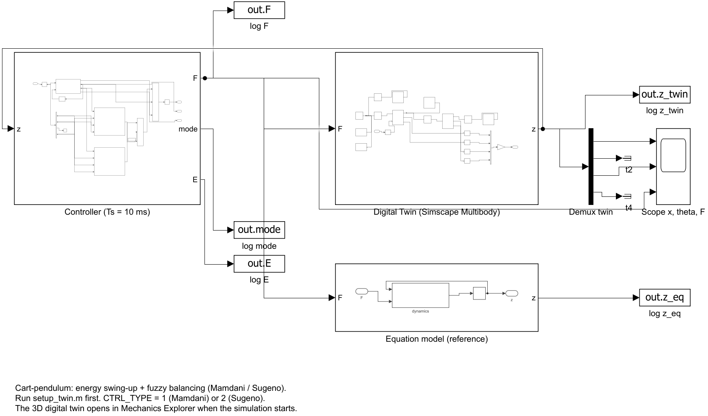
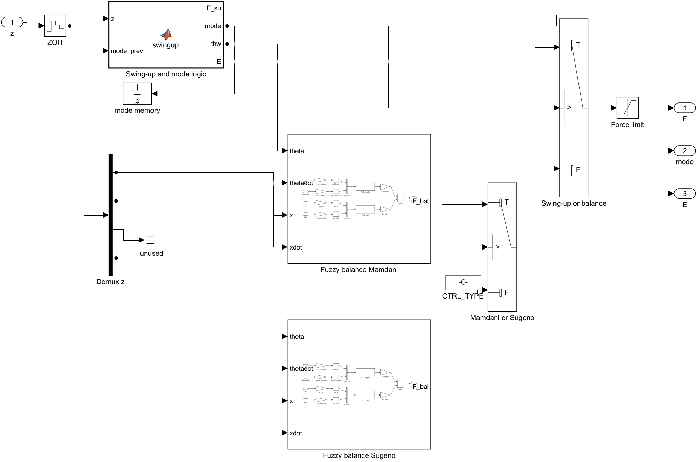

# simulink/ — the digital twin

| File | What it does |
|---|---|
| `cartpole_fuzzy_twin.slx` | The Simulink model (generated by `build_twin_model.m`). |
| `build_twin_model.m` | Generates the model from code, block by block. Rerun it after changing the structure: `build_twin_model(true)`. |
| `setup_twin.m` | Puts everything the model needs in the base workspace (`P`, the four FIS, scaling gains `SC_*`, `CTRL_TYPE`, `Tend`). **Run it before pressing Run in Simulink.** |

## Model structure



- **Digital Twin (Simscape Multibody)**: rail, cart on a prismatic joint (with viscous friction), rod on a revolute joint (with damping), gravity. Force input `F`, sensed outputs `z = [x, xdot, theta, thetadot]`. When the simulation starts, **Mechanics Explorer** opens the 3D view.
- **Equation model (reference)**: the same plant written as differential equations (MATLAB Function + Integrator), fed with the same force. Comparing the two validates the twin: during the swing-up their angles coincide (difference < 1e-4 rad).
- **Controller (Ts = 10 ms)**: zero-order hold, MATLAB Function block with the swing-up law and the switching logic (with a unit delay for the mode memory), two **Fuzzy balance** subsystems (Mamdani and Sugeno, each with two *Fuzzy Logic Controller* blocks), a switch selecting Mamdani/Sugeno (`CTRL_TYPE`), a switch selecting swing-up/balance, and the force limit.
- Logged signals (`To Workspace`, in `out`): `z_twin`, `z_eq`, `F`, `mode`, `E`.



## How to run

```matlab
init_project            % from the project root
CTRL_TYPE = 1;          % 1 = Mamdani, 2 = Sugeno
setup_twin
open_system('cartpole_fuzzy_twin')   % then press Run
```

or simply `main_twin(1)` / `main_twin(2)` from the project root, which also plays the 2D animation.
